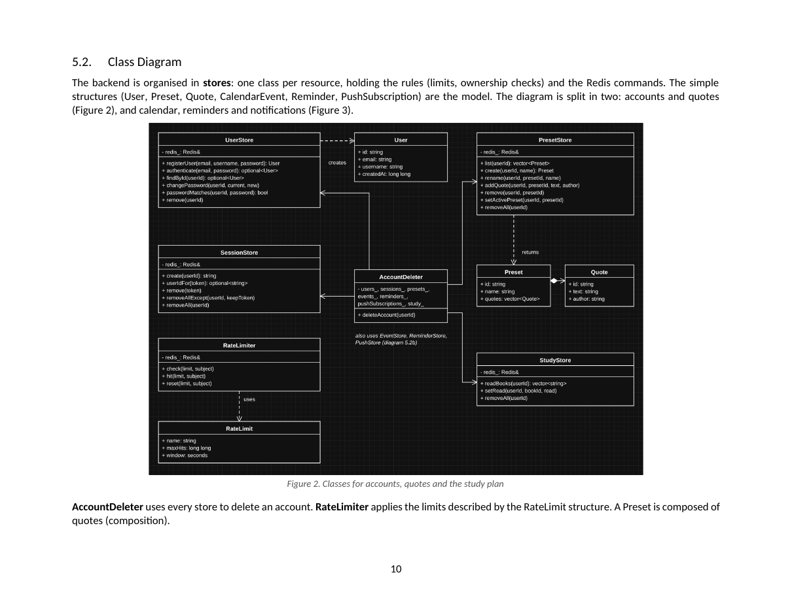

<!-- Page 10 of the documentation. Pages are images of Documentation_ubermenschs.pdf; click the page or "Next" to turn it. -->

<a href="09.md">◀ Previous</a> &nbsp;·&nbsp; <b>Page 10 of 22</b> &nbsp;·&nbsp; <a href="11.md">Next ▶</a>

  

<a href="09.md">◀ Previous</a> &nbsp;·&nbsp; <b>Page 10 of 22</b> &nbsp;·&nbsp; <a href="11.md">Next ▶</a>

<a href="../Documentation_ubermenschs.pdf">📄 The whole documentation (PDF)</a> &nbsp;·&nbsp; <a href="../../README.md">Back to the README</a>

